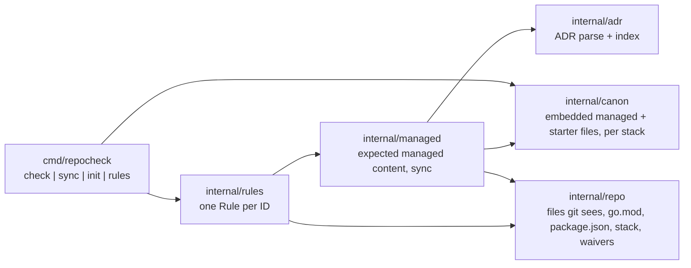

# repostd design

repostd distributes the discobox-ai repository standard and checks repos
against it. The standard is written once, as the `repostd` skill. Machine
checks enforce what can be checked; the skill carries the judgment rules.
[ADR 0001](docs/adr/0001-one-standard-enforced-by-repocheck-and-a-skill.md)
records the decisions and the alternatives rejected.

## Stacks

A repo is a **Go** repo (it has a `go.mod`, or neither manifest yet) or a
**node** repo (a `package.json` and no `go.mod`), detected by
`internal/repo` from the files rather than declared
([ADR 0002](docs/adr/0002-a-node-repo-follows-the-standard-with-its-own-tools.md)).
The stack picks two things: which distributed files a repo gets, and which
rules apply. Everything that is not toolchain is shared.

- `internal/canon/files/<managed|starter>/common` is every repo's;
  `go/` and `node/` beside it are added for that stack.
- A `Rule` names the stacks it applies to; none means all. `Run` skips the
  rest, so a node repo never sees `layout.root-dirs` or `env.go-tools`, and
  a Go repo never sees `env.node-*`. A shared rule that differs by stack
  (`ci.workflow`, `discobox.hooks`, `git.ignore`) branches on `r.Stack`.

## Distributed files

- **Managed** files are owned by repostd: the skill,
  `.github/actionlint.yaml` and `docs/adr/template.md` everywhere;
  `.golangci.yml` and `.github/actions/task/action.yml` in a Go repo;
  `oxlint.repostd.json`, `oxfmt.config.ts`, and the `pnpm` and
  `repocheck` composite actions in a node repo. `sync` rewrites them, and
  `managed.files` fails on drift. The only repo-owned content is their
  local blocks (`# repostd:local <name>` in `.golangci.yml`,
  `// repostd:local <name>` in `oxfmt.config.ts`), which sync carries over
  by name. oxlint's config needs none: oxlint merges an `extends` chain, so
  a repo's own `.oxlintrc.json` (a starter) extends the managed rules and
  owns its ignores, which oxlint does not merge. Sync never drops a block's lines: when the standard removes a
  block that still has content, sync skips the file and fails, and
  `managed.files` reports it.
- The **ADR index** in `docs/adr/README.md` is managed content inside a
  repo-owned file, between `repostd:adr-index` markers.
- **Starter** files are written by `init` only when missing, rendered with
  `[[ ]]` template delimiters (Taskfiles and workflows own `{{ }}`), and
  owned by the repo afterwards. Rules check their shape, not their bytes.
  `init` does not write a placeholder that would hide the repo's own
  version of a file, such as `DESIGN.md` beside a `docs/design.md`.
- Every embedded file has a `.tmpl` suffix, so git, direnv, and repocheck do
  not treat repostd's templates as repostd's own files.
- repostd conforms to itself: its root copies of managed files come from
  `repocheck sync`, and `task verify` fails if they drift.

## Rules

- A rule is an ID, a one-line summary, and a check over `repo.Repo`. The IDs
  are the contract: the skill cites each one next to its rule text, and a
  test fails when the skill and `rules.All()` disagree.
- A check sees the files git lists (tracked plus untracked-not-ignored), so
  ignored build output never trips a rule.
- Waivers (`.repocheck.yaml`) match by rule and an optional path glob or
  directory prefix, and need a reason. Waived findings are counted, and
  listed with `-waived`.
- Warnings never fail. Only `docs.design-length` uses them, at 300 lines.
- Checks read structure, not semantics. YAML is parsed; `uses:` pinning is
  checked line by line because the version comment is not in the YAML
  model. Mermaid is checked for a known diagram type, not fully parsed.
